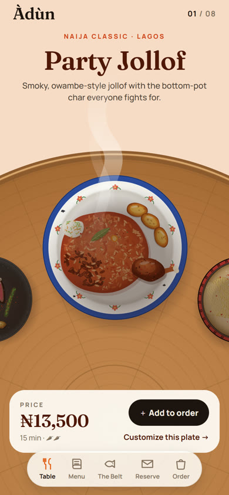
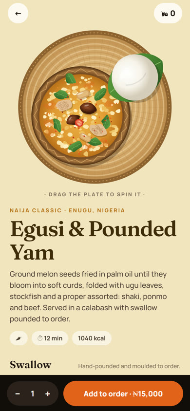
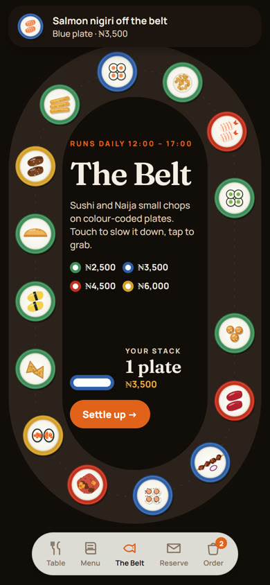
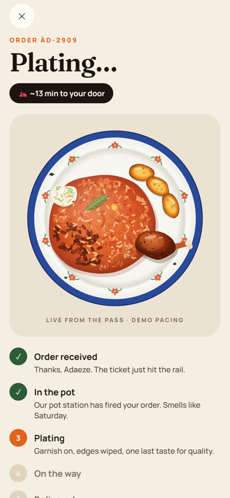
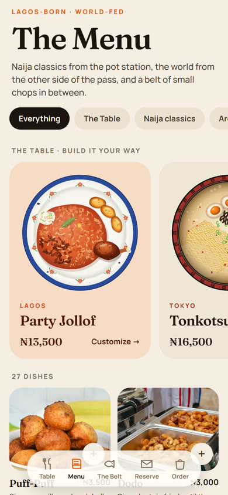
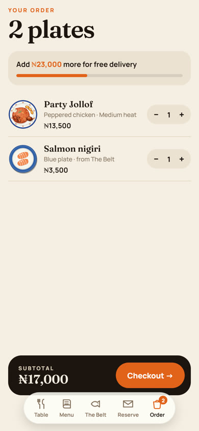
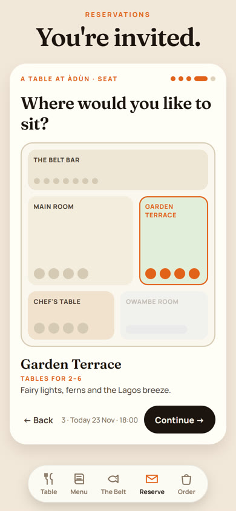
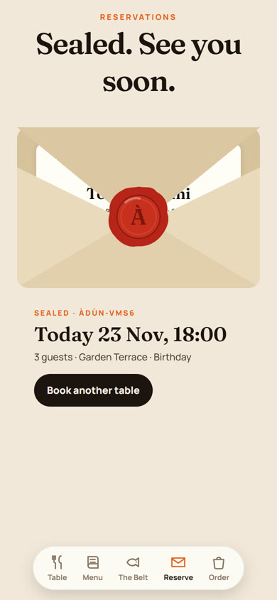

# Àdùn for iOS & Android

> *Àdùn* is Yoruba for **deliciousness**. Lagos-born. World-fed.

The phone app for [Àdùn](https://adun-rose.vercel.app), a concept Lagos restaurant where party jollof, egusi and suya share a revolving table with tonkotsu, carbonara and a sushi belt. It's built natively with Expo and React Native, not wrapped around the website, so the table spins under your thumb, plates click into place with haptics, and everything runs at the phone's full frame rate.

<p align="center">
  
  
  
  
</p>

## What's inside

| Screen | What it does |
| --- | --- |
| **The Table** | A wooden lazy-Susan of eight signature plates. Spin it with your thumb; it carries momentum, springs onto the nearest dish and clicks with a haptic. The background colour morphs between each dish's palette as it turns, steam rises off the front plate and its ingredient callouts cycle underneath. Tap a neighbour to rotate to it, tap the front plate to customise it. |
| **Menu** | Category chips over 35 dishes. A snapping carousel of the drawn signature plates, and a photo grid that reflows with spring layout animations. Every card adds to the order in one tap. |
| **Dish builder** | Every option redraws the plate: pounded yam, eba or amala change the swallow; goat meat and stockfish land in the pot; heat adds peppers. Flick the plate to spin it. |
| **The Belt** | Sixteen colour-coded plates of sushi and Naija small chops glide round a stadium conveyor. Touch it to slow it down, tap a plate to grab it, and watch your stack grow. |
| **Order** | Cart with a free-delivery progress bar, then checkout: six Lagos delivery zones, pickup slots, tips, promo codes (`JOLLOF10`, `OWAMBE`), 7.5% VAT and validation that shakes the field and buzzes. |
| **Tracker** | The plate assembles itself stage by stage while a rider crosses a stylised Lagos map. Confetti and a success haptic on delivery, then a rating and one-tap reorder. |
| **Reserve** | An envelope opens itself and the letter becomes a five-step booking: guests, date, time, a tappable floor plan (Belt Bar, Main Room, Garden Terrace, Chef's Table, Owambe Room) and details. Sealing it stamps wax with a heavy haptic. |

<p align="center">
  
  
  
  
</p>

> **No backend.** The cart, orders and reservations live on the phone (Zustand + AsyncStorage). No payment is taken and nothing you type leaves the device.

## Run it on your phone

1. Install **Expo Go** from the App Store or Google Play.
2. On your computer:

   ```bash
   npm install
   npx expo start
   ```

3. Scan the QR code: with the Camera app on iPhone, or from inside Expo Go on Android. Your phone and computer need to be on the same Wi-Fi.

`npx expo start --web` opens a browser preview at phone size, handy for quick checks.

## Tech

- **Expo SDK 58** on **React Native 0.88** and **React 19.3**, TypeScript, Expo Router with typed routes, React Compiler
- **Native tabs** (`expo-router/native-tabs`): Liquid Glass on iOS 26, Material on Android, with the cart count as a native badge
- **Reanimated 4.7** for every animation, running on the UI thread: the table's rotation is one shared value that drives eight plates, the turntable and the background colour
- **Gesture Handler 3.3** (`usePanGesture`) for the table spin and the plate flick
- **react-native-svg** for all the food, **expo-haptics**, **expo-image**, **Zustand** + **AsyncStorage**
- **Fraunces** and **Manrope** via `@expo-google-fonts`, the same type as the website

### The food is drawn in code

Every signature plate, topping and belt plate is the website's procedural SVG engine (`src/art`), converted tag-for-tag to react-native-svg, so the grains of jollof and slices of steak are identical on the site and the phone. Ingredients are separate layers marked with build stages; `src/art/svg.tsx` reads those markers so the order tracker can assemble a plate one stage at a time.

## Project structure

```
src/
  app/
    (tabs)/            index (The Table), menu, belt, reserve, cart (Order)
                       _layout.tsx = native tabs, _layout.web.tsx = browser tab bar
    dish/[slug].tsx    dish builder
    checkout.tsx       checkout
    order.tsx          live order tracker
    _layout.tsx        fonts, splash, root stack, toasts
  art/                 procedural SVG food engine, ported from the website
  components/          Pressy (spring + haptic pressable), Steam, Thumb, Toaster
  lib/                 menu data, store, theme tokens, haptics, checkout rules, rider route
assets/food/           photography (Unsplash licence)
```

## Credits

Photography by Unsplash contributors, used under the [Unsplash License](https://unsplash.com/license); see the website's [/credits](https://adun-rose.vercel.app/credits). Illustrations, UI and code are original. Designed and built by [Essien Abasiama](https://essienabasiama.vercel.app).

*Àdùn is a concept restaurant, not a real place (yet).*
